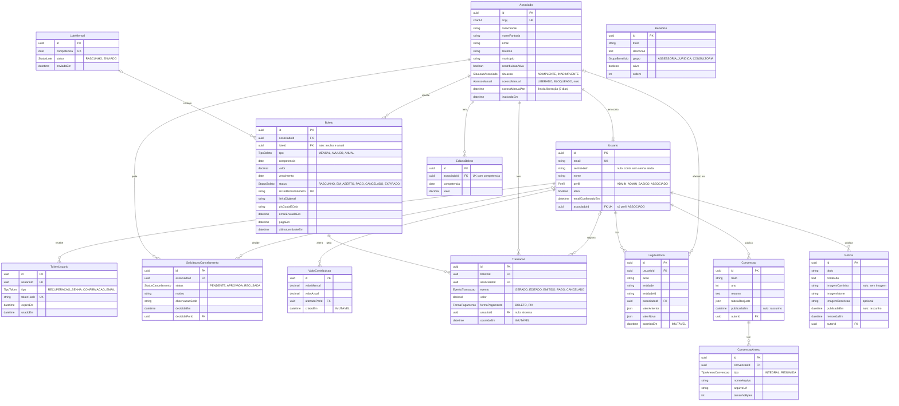

# Elo Connect — Modelo de Dados (DER)

Última atualização: 01/11/2026.

Fonte da verdade do banco: [`apps/api/prisma/schema.prisma`](../apps/api/prisma/schema.prisma). Este documento explica o modelo e as decisões; se os dois divergirem, vale o schema, e este documento deve ser corrigido no mesmo PR.

Documentos relacionados: [Requisitos](requisitos.md) (regras RN, requisitos RF e pendências P) e [Decisões Técnicas](decisoes-tecnicas.md).

## Diagrama



O diagrama mostra os campos principais. Todas as tabelas também têm `criadoEm`, e as que podem ser editadas têm `atualizadoEm`.

## Decisões de modelagem

**Nomes em português.** Tabelas e colunas usam os termos do glossário (Associado, contribuicaoAtiva, LogAuditoria), para não ser preciso traduzir entre os requisitos e o banco. O código técnico em volta (Service, Controller, Module) continua em inglês, como manda o NestJS.

**IDs em UUID v7.** Não expõem a quantidade de registros nas URLs e são ordenáveis por data de criação.

**Usuário e associado são tabelas separadas.** O associado é a farmácia; o usuário é a conta de acesso. Um associado pode existir sem conta, como as ~1.850 farmácias que só recebem a cobrança formal. Cada associado tem no máximo uma conta, que o contador também usa (RN29). Usuários da sede têm perfil ADMIN (chave mestre, todas as funções) ou ADMIN_BASICO (publica conteúdo e consulta associados, RN33) e nenhum associado.

**Conta criada pelo CNPJ** (RF05, RN21). No primeiro pedido, o sistema cria o `Usuario` com o e-mail do cadastro do associado e sem senha (`senhaHash` nulo), e manda um token `CONFIRMACAO_EMAIL`, válido por 24 horas. Ao criar a senha pelo link, a conta ganha `senhaHash` e `emailConfirmadoEm` e passa a entrar. Enquanto isso não acontece, o login recusa a conta.

**E-mail único por farmácia** (RN34). O e-mail do cadastro do associado é o mesmo da conta. Quando a sede troca o e-mail de um associado que tem conta, o `Usuario.email` muda junto, os tokens ainda não usados deixam de valer, o log de auditoria ganha a ação `CONTA_EMAIL_ALTERADO` e o associado recebe um aviso no e-mail antigo e no novo. Se o e-mail novo já for de outra conta, a API recusa (409).

**Situação armazenada, com override manual** (RN09 a RN11, RN22):

- `situacao` (ADIMPLENTE ou INADIMPLENTE) é a situação **automática**. O pagamento torna o associado adimplente (RF15), e o job de expiração, 30 dias após o vencimento sem pagamento, o torna inadimplente (RF16). Novo associado começa INADIMPLENTE e sem contribuição ativa. Na tela, INADIMPLENTE sem contribuição ativa aparece como "Sem contribuição ativa" (RN22).
- `acessoManual` guarda a decisão **manual** da sede (RN11). Fica nulo enquanto a sede não interfere, e o acesso segue a situação automática. Com valor (LIBERADO ou BLOQUEADO), prevalece sobre a situação, e os jobs automáticos não o alteram.
- A liberação manual vale 7 dias (RN11): `acessoManualAte` guarda o fim dela. Vencida, ela deixa de contar e o acesso volta a seguir a `situacao`, sem job (a data é conferida na hora, como no boleto vencido). O bloqueio manual não tem data e vale até a sede mudar.
- **Acesso a benefícios e suporte** = `acessoManual` em vigor (`acessoManualEmVigor`, no `packages/shared`), se preenchido; senão, `situacao`.
- "Cancelamento solicitado" (RF06) não é um terceiro valor de situação: é o associado ter uma `SolicitacaoCancelamento` PENDENTE.

**Contribuição ativa** (`contribuicaoAtiva`) define quem entra no lote mensal e recebe lembretes (RN05, RN22). É ligada pelo próprio associado (RN23) e desligada por cancelamento aprovado ou pela sede (RN25).

**Boleto vencido é calculado.** Não existe status VENCIDO: um boleto EM_ABERTO com `vencimento` no passado está vencido. Evita que um job precise atualizar boletos todo dia.

**Boleto expirado é guardado** (RN03, RN09, RF16). O boleto vale até 30 dias depois do vencimento. No dia seguinte, o job diário do bloqueio marca o boleto EM_ABERTO como EXPIRADO, com o evento EXPIRADO no histórico, e torna o associado INADIMPLENTE. A decisão manual da sede (`acessoManual`) não muda. O banco não recebe mais o boleto expirado.

**Lote mensal** agrupa os boletos MENSAL de uma competência, gerados e enviados sozinhos no primeiro dia útil, sem revisão (RN04). Ninguém da sede envia o lote (P20): ele nasce em RASCUNHO, com os boletos ainda por emitir no banco, e passa a ENVIADO quando todos foram emitidos. Boletos avulsos e anuais ficam fora do lote até as pendências P10 e P04 serem respondidas.

**Valor de cada boleto.** Uma alteração de valor vale a partir do boleto do mês seguinte (RN15). O boleto de uma competência usa o `ValorContribuicao` mais recente criado antes do primeiro dia desse mês, no horário de Cuiabá. Por isso, a data de início não precisa de coluna própria.

**Edição do boleto do mês seguinte** (RN04, RF11). A sede muda só o valor do boleto mensal de um associado, e só para um mês (decisão do grupo, 01/11/2026). Como o boleto ainda não existe, a edição fica numa tabela à parte, a `EdicaoBoleto`, com uma linha por associado e competência. A edição feita num mês vale para o boleto do mês seguinte, no horário de Mato Grosso, como a mudança de valor (RN15), e pode ser trocada ou desfeita até o mês virar. Desfazer apaga a linha. Quem editou, quando e os valores de antes e depois ficam no log de auditoria. O lote mensal usa o valor da edição no lugar do valor da contribuição.

**E-mail do boleto** (RF12). `emailEnviadoEm` guarda quando o e-mail com o boleto saiu para o associado. Num boleto emitido, nulo quer dizer que o e-mail ainda não saiu, e a próxima execução do lote tenta de novo. Como o `ultimoLembreteEm`, é um controle do envio: não muda o boleto e não entra no histórico de transações.

**Dinheiro em `Decimal(10,2)`**, nunca em ponto flutuante.

**Histórico de cada boleto (RN17, RF30).** Todo código que cria ou muda um boleto usa o `TransacoesService` (`apps/api/src/cobranca`). Ele grava a linha da `Transacao` na mesma transação do banco da mudança: se uma das duas falhar, nenhuma entra. A linha guarda uma cópia do valor e do nosso número daquele momento, a forma de pagamento (só no `PAGO`) e quem da sede fez a mudança (nulo quando foi o sistema). Linhas gravadas na mesma transação do banco ficam com a mesma data e hora.

**Notícia publicada na hora.** A tela da sede publica a notícia ao salvar, e `publicadaEm` é a data que o feed mostra. Editar não muda essa data. O rascunho (`publicadaEm` nulo) continua no modelo, mas a sede ainda não tem tela para ele.

**Uma imagem por notícia, opcional (RF41).** Fica em colunas da própria `Noticia`, não numa tabela à parte, porque a notícia tem no máximo uma. O arquivo fica no mesmo Vercel Blob privado dos PDFs das convenções (`imagemCaminho` guarda o caminho dele) e só sai pela API, para quem está logado (RN28). `imagemNome` é o nome do arquivo que a sede enviou, para o log de auditoria, e `imagemDescricao` é o texto para leitor de tela (RNF02). A notícia removida guarda a imagem, como guarda o texto.

**Convenção publicada com os dois PDFs.** A sede cria a convenção como rascunho (`publicadaEm` nulo), envia o PDF integral e o resumido e publica. A API só publica com os dois. Cada convenção tem no máximo um `ConvencaoAnexo` de cada `tipo`, e enviar outro troca o anterior. O arquivo fica no Vercel Blob, numa área privada (`arquivoUrl` guarda o caminho dele), e só sai pela API: a sede abre os dois, e o associado em atraso que pede o integral recebe o resumido (RN12).

**Exclusões.** Associado é inativado (`inativadoEm`), não excluído (RF08). Notícia removida recebe `removidaEm` e some do feed, e benefício removido fica com `ativo` falso; nos dois casos, o registro fica para o log de auditoria. As chaves estrangeiras usam `Restrict`: nada que tenha histórico pode ser apagado em cascata. As exceções são tokens (apagados com o usuário) e anexos (apagados com a convenção).

## Tabelas imutáveis

| Tabela | Regra | O que guarda |
| --- | --- | --- |
| `ValorContribuicao` | RN16, RF20 | Cada alteração de valor é um registro novo, com o mensal digitado pela sede e o anual calculado (P23). O valor atual é o mais recente; o anterior é o de antes. |
| `Transacao` | RN17, RF30 | Cada evento de um boleto (gerado, editado, emitido, pago, cancelado, expirado), com cópia do valor e do nosso número no momento do evento. |
| `LogAuditoria` | RN26, RF39 | Cada ação de um usuário da sede, com valor anterior e novo. |

A imutabilidade é garantida **pelo próprio banco**: triggers recusam UPDATE, DELETE e TRUNCATE nessas tabelas (migration `init`), mesmo que o código da API tenha um erro. O teste `apps/api/test/imutabilidade.e2e-spec.ts` confere isso. Para corrigir um registro errado, inclua um registro novo; nunca altere o antigo.

**Como gravar no log de auditoria.** Toda ação de um usuário da sede chama o `AuditoriaService` (`apps/api/src/auditoria/`) dentro da mesma transação da alteração. Assim, a alteração e o registro entram juntos, ou nenhum dos dois entra:

```ts
await this.prisma.$transaction(async (tx) => {
  const antes = await tx.associado.findUniqueOrThrow({ where: { id } });
  await tx.associado.update({ where: { id }, data: dados });
  await this.auditoria.registrar(tx, {
    usuarioId, // o `sub` do token
    acao: 'ASSOCIADO_EDITADO',
    entidade: 'Associado',
    entidadeId: id,
    associadoId: id,
    ...diferencas(antes, dados), // só os campos que mudaram
  });
});
```

Os nomes das ações ficam no catálogo `ACOES_AUDITORIA` (`packages/shared/src/auditoria.ts`), que cada funcionalidade nova completa, junto com o texto da ação em `TEXTO_ACAO_AUDITORIA`. O `valorAnterior` e o `valorNovo` guardam só os campos que mudaram, e as datas viram texto ISO. Um campo novo no log ganha o nome que aparece na tela em `NOMES_CAMPOS` (`apps/web/src/paginas/admin/PaginaLogAuditoria.tsx`), onde a sede consulta o log (RF40).

## O que depende de pendência

| Ponto do modelo | Pendência | Situação atual |
| --- | --- | --- |
| Campos cadastrais do `Associado` (razão social, nome fantasia, e-mail, telefone, município) | P02, RF42 | Conjunto mínimo provisório. Não existe lista atual dos associados (P09, respondida), então a planilha modelo da carga inicial parte deste conjunto. Novos campos entram por migration. |
| Boleto ANUAL: fora do lote? renovação? | P04, P15 | Tipo existe; regras de geração ainda não. |
| Boleto AVULSO e boleto único dos meses em aberto (RN24, RN30) | P10 (em parte) | O tipo AVULSO existe. O pedido que passa pela sede (boleto dos meses em aberto e segundo avulso do mês) precisa de um registro de pedido, com aprovação ou recusa. Um boleto que junta vários meses precisa de uma ligação com as competências que ele quita. Tabelas novas, desenhadas com a #63. |
| Aceite do termo de adesão (RN23) | P21 | **Fora do modelo** até a #43: data, hora e versão do termo aceito. |
| Valor anual (`valorAnual`) | P23 | Calculado e gravado junto com o mensal (12 vezes o mensal, com 20% de desconto), para o histórico mostrar o que valia. |
| Tabela de reajuste da convenção | P24 | O campo `tabelaReajuste` (JSON) existe, mas fica sem uso até a resposta. |
| Inscrição em convenção | P05 | **Fora do modelo** até a resposta. |
| Lista de benefícios | P06, P15 | Tabela genérica (título, descrição, grupo e ordem), cadastrada pela sede. O `grupo` separa assessoria jurídica e consultoria (RN32); a regra de acesso de cada grupo depende da P15. |
| Matriz e filiais (RN31) | P14 | **Fora do modelo**. Provavelmente, uma ligação da filial com a matriz no `Associado`. |
| Confirmação automática do cancelamento (RN18) | — | Status APROVADA com `decididaPorId` nulo = confirmado pelo sistema depois de 15 dias sem recusa (#56). |
| Aceite do compartilhamento com o contador | P11 | **Fora do modelo**. Se for preciso registrar data e hora do aceite, entra um campo em `Usuario`. |
| Retenção e exclusão de dados (LGPD) | P07 | Inativação em vez de exclusão. Revisar quando houver orientação. |
| Efeitos da inativação e reativação do associado | P13 | A inativação só preenche `inativadoEm` (o guard já barra benefícios e suporte); a reativação limpa o campo. |
| Campos do Sicredi (nosso número, linha digitável, Pix) | Estudo #40 | Provisórios. |
| Tamanho dos PDFs das convenções | P24 | Até 4 MB cada, por causa do limite de 4,5 MB por requisição da Vercel. PDFs maiores pedem outro jeito de envio. |

As duas perguntas que surgiram na modelagem foram respondidas em 27/10/2026: a sede não tem base com os dados das farmácias que já pagam (resposta 42), e a sede pode recusar um pedido de cancelamento em até 15 dias (resposta 28), o que confirma o status RECUSADA.

**Fica para as próximas fases**, com migrations próprias: importação da base da JUCEMAT (P02), envio da cobrança formal (RF29) e o registro de e-mails enviados.

## Dados de desenvolvimento

O seed (`apps/api/prisma/seed.ts`) cria só dados fictícios (RNF10): CNPJs gerados com dígito verificador válido e e-mails `@example.com`. A senha de todos os usuários é `eloconnect123`. Na demonstração, a senha vem da variável `SEED_SENHA` ([deploy.md](deploy.md)).

| Usuário | Perfil | Para testar |
| --- | --- | --- |
| `admin@example.com` | Admin (chave mestre) | Painel da sede, com todas as funções |
| `sede@example.com` | Admin básico | Perfil básico da sede (RN33) e segundo usuário para os filtros do log de auditoria |
| `associado@example.com` | Associado | Farmácia 01, adimplente, com boleto pago |
| `inadimplente@example.com` | Associado | Farmácia 07, com boleto vencido em aberto |

Também cria 20 associados (8 com contribuição ativa), o lote do mês passado com boletos e transações, uma convenção, notícias e benefícios de exemplo. Cenários incluídos: o associado 5 está adimplente mas bloqueado manualmente pela sede, e o associado 3 tem um pedido de cancelamento pendente. Os associados 2 a 6 e 8 a 20 têm e-mail no cadastro e ainda não têm conta, então servem para testar a criação de conta pelo CNPJ (o da Farmácia 02 é `41.015.838/0001-36`).

| Comando | O que faz |
| --- | --- |
| `pnpm --filter api db:migrate` | Cria e aplica uma migration nova a partir do schema |
| `pnpm --filter api db:seed` | Popula o banco (só se estiver vazio) |
| `pnpm --filter api db:reset` | **Apaga o banco local**, reaplica as migrations e roda o seed |
| `pnpm --filter api db:studio` | Abre o Prisma Studio para ver os dados |

## Como alterar o modelo

1. Altere `apps/api/prisma/schema.prisma`.
2. Rode `pnpm --filter api db:migrate` e dê um nome à migration (ex.: `associado-campos-cadastrais`).
3. Atualize este documento (diagrama e decisões) no mesmo PR.
4. Nunca edite uma migration que já está no `main`: crie outra.
