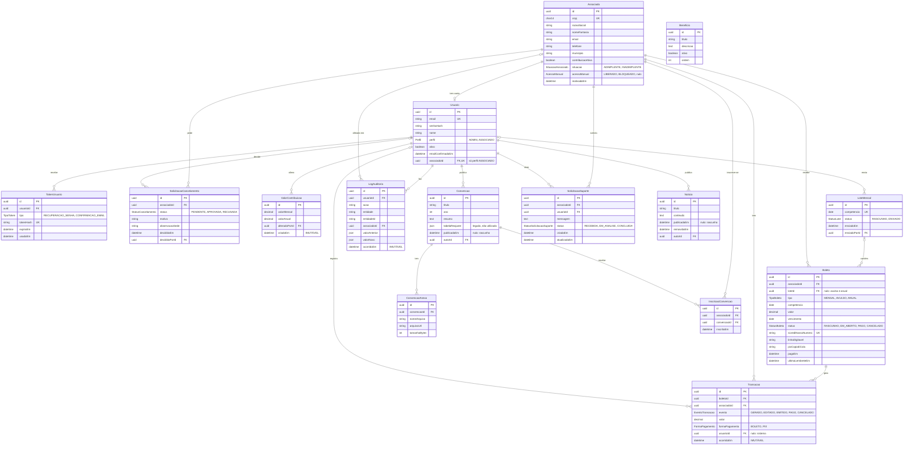

# Elo Connect — Modelo de Dados (DER)

Última atualização: 11/10/2026.

Fonte da verdade do banco: [`apps/api/prisma/schema.prisma`](../apps/api/prisma/schema.prisma). Este documento explica o modelo e as decisões; se os dois divergirem, vale o schema, e este documento deve ser corrigido no mesmo PR.

Documentos relacionados: [Requisitos](requisitos.md) (regras RN, requisitos RF e pendências P) e [Decisões Técnicas](decisoes-tecnicas.md).

## Diagrama

O diagrama mostra os campos principais. Todas as tabelas também têm `criadoEm`, e as que podem ser editadas têm `atualizadoEm`.

## Decisões de modelagem

**Nomes em português.** Tabelas e colunas usam os termos do glossário (Associado, contribuicaoAtiva, LogAuditoria), para não ser preciso traduzir entre os requisitos e o banco. O código técnico em volta (Service, Controller, Module) continua em inglês, como manda o NestJS.

**IDs em UUID v7.** Não expõem a quantidade de registros nas URLs e são ordenáveis por data de criação.

**Usuário e associado são tabelas separadas.** O associado é a farmácia; o usuário é a conta de acesso. Um associado pode existir sem conta, como as ~1.850 farmácias que só recebem a cobrança formal. Cada associado tem no máximo uma conta, que o contador também usa (RN29). Usuários da sede têm perfil ADMIN e nenhum associado.

**Situação armazenada, com override manual** (RN09 a RN11, RN22):

- `situacao` (ADIMPLENTE ou INADIMPLENTE) é a situação **automática**. O pagamento torna o associado adimplente (RF15) e o job de vencimento o torna inadimplente (RF16). Novo associado começa INADIMPLENTE, porque o glossário define inadimplente também como quem não contribui.
- `acessoManual` guarda a decisão **manual** da sede (RN11). Fica nulo enquanto a sede não interfere, e o acesso segue a situação automática. Com valor (LIBERADO ou BLOQUEADO), prevalece sobre a situação, e os jobs automáticos não o alteram.
- **Acesso a benefícios e suporte** = `acessoManual`, se preenchido; senão, `situacao`.
- "Cancelamento solicitado" (RF06) não é um terceiro valor de situação: é o associado ter uma `SolicitacaoCancelamento` PENDENTE.

**Contribuição ativa** (`contribuicaoAtiva`) define quem entra no lote mensal e recebe lembretes (RN05, RN22). É ligada pelo próprio associado (RN23) e desligada por cancelamento aprovado ou pela sede (RN25).

**Boleto vencido é calculado.** Não existe status VENCIDO: um boleto EM_ABERTO com `vencimento` no passado está vencido. Evita que um job precise atualizar boletos todo dia.

**Lote mensal** agrupa os boletos MENSAL de uma competência para a revisão e o envio pela sede (RN04). Boletos avulsos e anuais ficam fora do lote até as pendências P10 e P04 serem respondidas.

**Dinheiro em `Decimal(10,2)`**, nunca em ponto flutuante.

**Exclusões.** Associado é inativado (`inativadoEm`), não excluído (RF08). Notícia removida recebe `removidaEm` e some do feed, mas o registro fica para o log de auditoria. As chaves estrangeiras usam `Restrict`: nada que tenha histórico pode ser apagado em cascata. As exceções são tokens (apagados com o usuário) e anexos (apagados com a convenção).

## Tabelas imutáveis

| Tabela | Regra | O que guarda |
| --- | --- | --- |
| `ValorContribuicao` | RN16, RF20 | Cada alteração de valor é um registro novo. O vigente é o mais recente; o anterior é o de antes. |
| `Transacao` | RN17, RF30 | Cada evento de um boleto (gerado, editado, emitido, pago, cancelado), com cópia do valor e do nosso número no momento do evento. |
| `LogAuditoria` | RN26, RF39 | Cada ação de um usuário da sede, com valor anterior e novo. |

A imutabilidade é garantida **pelo próprio banco**: triggers recusam UPDATE, DELETE e TRUNCATE nessas tabelas (migration `init`), mesmo que o código da API tenha um erro. O teste `apps/api/test/imutabilidade.e2e-spec.ts` confere isso. Para corrigir um registro errado, inclua um registro novo; nunca altere o antigo.

## O que depende de pendência

| Ponto do modelo | Pendência | Situação atual |
| --- | --- | --- |
| Campos cadastrais do `Associado` (razão social, nome fantasia, e-mail, telefone, município) | P02, P09 e pergunta nova abaixo | Conjunto mínimo provisório. Novos campos entram por migration. |
| Estados do boleto depois dos 30 dias de validade | P01 | Pode exigir um status a mais (ex.: EXPIRADO). |
| Boleto ANUAL: fora do lote? renovação? | P04 | Tipo existe; regras de geração ainda não. |
| Boleto AVULSO: geração, vencimento, período de acesso | P10 | Tipo existe; regras de geração ainda não. |
| Inscrição em convenção | RF23 | `InscricaoConvencao` registra uma inscrição única por associado e convenção, com data automática. |
| Solicitação de suporte | RF25 | `SolicitacaoSuporte` registra a mensagem do afiliado adimplente e o status de acompanhamento pela sede. |
| Lista de benefícios | P06 | Tabela genérica (título, descrição, ordem). |
| Aceite do compartilhamento com o contador | P11 | **Fora do modelo**. Se for preciso registrar data e hora do aceite, entra um campo em `Usuario`. |
| Retenção e exclusão de dados (LGPD) | P07 | Inativação em vez de exclusão. Revisar quando houver orientação. |
| Campos do Sicredi (nosso número, linha digitável, Pix) | Estudo #40 | Provisórios. |
| Onde ficam os PDFs das convenções | Estudo #28 | `arquivoUrl` genérico. |

**Perguntas novas para o cliente**, surgidas na modelagem:

- Quais dados cadastrais da farmácia a sede usa hoje? (Pedir só os nomes das colunas da planilha ou da base, sem dados reais.)
- A sede pode **recusar** um pedido de cancelamento (por exemplo, quando o associado desiste depois do contato da sede), ou só aprovar? O modelo prevê RECUSADA, mas o requisito (RN18) fala só em "validar".

**Fica para as próximas fases**, com migrations próprias: importação da base da JUCEMAT (P02), envio da cobrança formal (RF29) e o registro de e-mails enviados.

## Dados de desenvolvimento

O seed (`apps/api/prisma/seed.ts`) cria só dados fictícios (RNF10): CNPJs gerados com dígito verificador válido e e-mails `@example.com`. A senha de todos os usuários é `eloconnect123`.

| Usuário | Perfil | Para testar |
| --- | --- | --- |
| `admin@example.com` | Admin | Painel da sede |
| `sede@example.com` | Admin | Segundo usuário da sede (filtros do log de auditoria) |
| `associado@example.com` | Associado | Farmácia 01, adimplente, com boleto pago |
| `inadimplente@example.com` | Associado | Farmácia 07, com boleto vencido em aberto |

Também cria 20 associados (8 com contribuição ativa), o lote do mês passado com boletos e transações, uma convenção, notícias e benefícios de exemplo. Cenários incluídos: o associado 5 está adimplente mas bloqueado manualmente pela sede, e o associado 3 tem um pedido de cancelamento pendente.

| Comando | O que faz |
| --- | --- |
| `pnpm --filter api db:migrate` | Cria e aplica uma migration nova a partir do schema |
| `pnpm --filter api db:seed` | Popula o banco (só se estiver vazio) |
| `pnpm --filter api db:reset` | **Apaga o banco local**, reaplica as migrations e roda o seed |
| `pnpm --filter api db:studio` | Abre o Prisma Studio para ver os dados |

## Como alterar o modelo

1. Altere `apps/api/prisma/schema.prisma`.
2. Rode `pnpm --filter api db:migrate` e dê um nome à migration (ex.: `associado-campos-cadastrais`).
3. Atualize este documento (diagrama e decisões) no mesmo PR.
4. Nunca edite uma migration que já está no `main`: crie outra.
